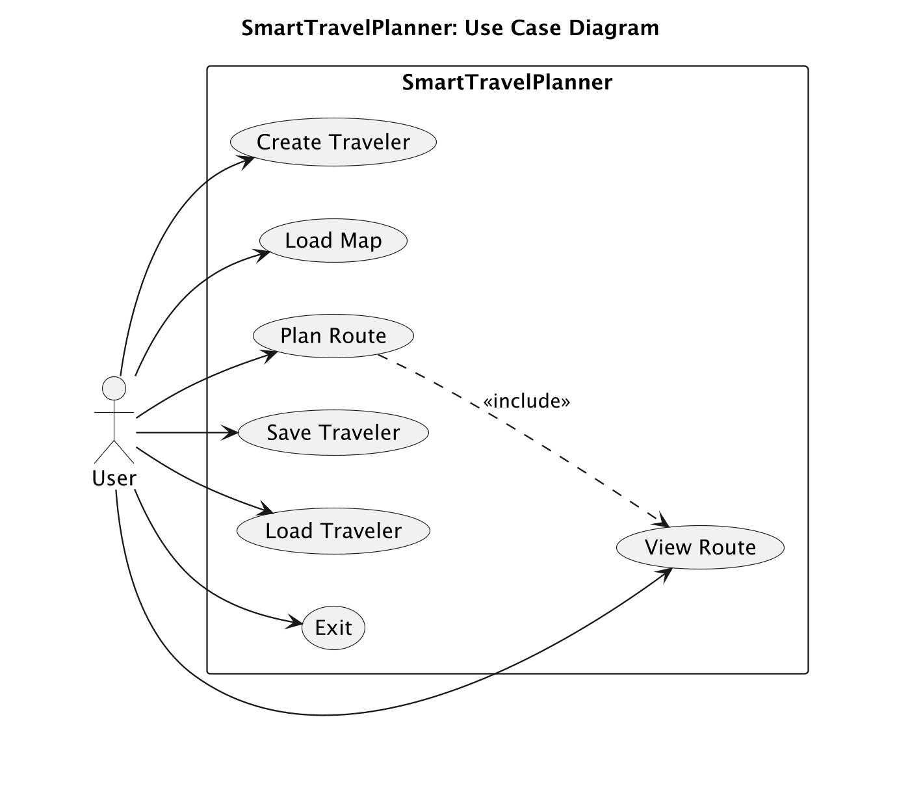
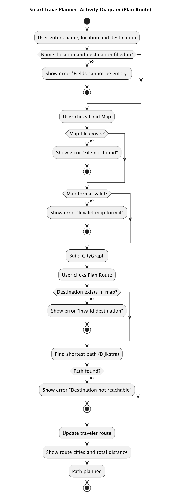
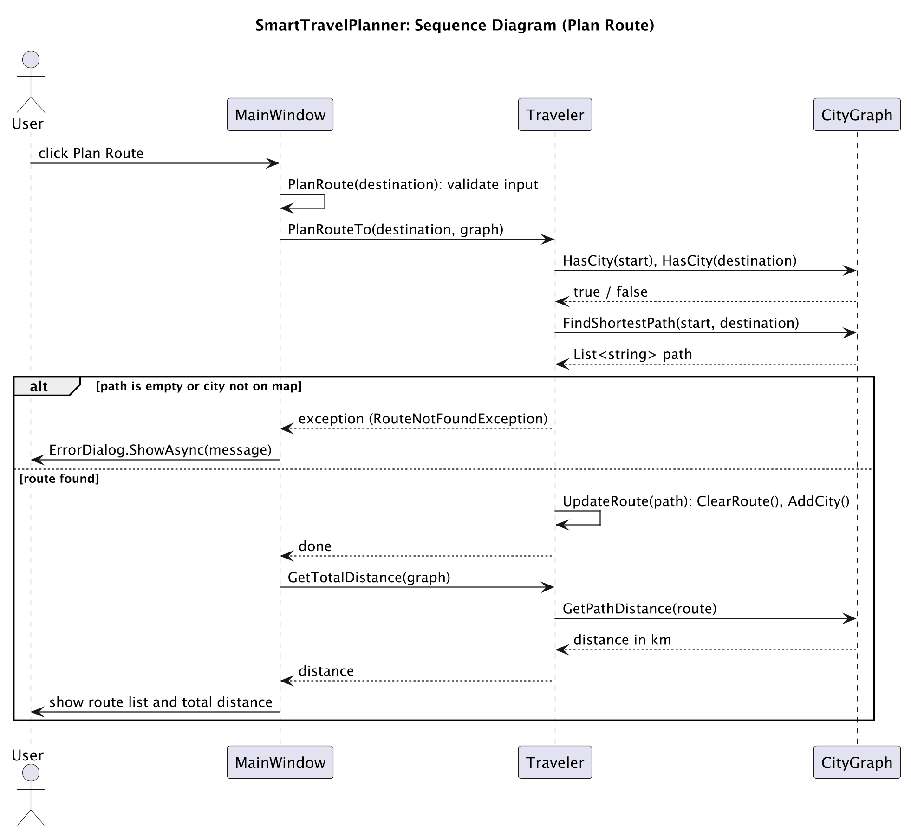

# SmartTravelPlanner

A desktop app for planning the shortest route between cities. You create a traveler, load a map of cities and distances, enter a destination, and the app finds the shortest path with Dijkstra's algorithm and shows the route and total distance.

Built with C# and Avalonia UI.

## Features

- Create a traveler (name and current location)
- Load a city map from a `.txt` file
- Plan the shortest route to a destination
- Show the route cities and the total distance
- Add or remove a road (two cities and a distance) on the map
- Save and load the traveler as a `.json` file
- Error dialogs for a missing or invalid file, empty fields, and unreachable or unknown cities

## Requirements

- .NET SDK 10.0 (the project targets `net10.0`)

## Build

```
cd SmartTravelPlanner
dotnet build SmartTravelPlanner.csproj
```


## Run

```
dotnet run --project SmartTravelPlanner.csproj
```

To create a standalone binary:

```
dotnet publish SmartTravelPlanner.csproj -c Release -r osx-arm64 --self-contained
```

Use `win-x64` for Windows or `osx-x64` for an Intel Mac.

## How to use

1. Enter a name and a location, then click **Create Traveler**.
2. Click **Load Map** and choose a map file.
3. Enter a destination and click **Plan Route**.
4. The route and total distance appear on the right.
5. Use **Save** and **Load** to store the traveler in a `.json` file.

> **Note:** if you change the name or location after creating the traveler, click **Create Traveler** again. Otherwise the app keeps using the old values.

## Map file format

One road per line: `CityA-CityB,Distance`. Roads work in both directions. A sample map is in `maps/map.txt`.

```
Kyiv-Lviv,540
Lviv-Warsaw,390
Warsaw-Berlin,310
Kyiv-Odesa,480
Oslo-Stockholm,520
```

Example: Kyiv to Berlin gives `Kyiv -> Lviv -> Warsaw -> Berlin`, 1240 km. Oslo is not connected to the other cities, so planning a route to it shows an error.

City names cannot contain a hyphen, because `-` separates the two cities.

## Traveler file format

```json
{
  "name": "Alice",
  "currentLocation": "Kyiv",
  "route": ["Kyiv", "Lviv", "Warsaw", "Berlin"]
}
```

## Diagrams

### Use Case Diagram



### Activity Diagram



### Sequence Diagram

